# markov_decision_process

Examples of Markov Decision Processes (MDPs)

## Running the Python code

The Python code uses [uv](https://docs.astral.sh/uv/) to manage dependencies
(pinned in [python/uv.lock](python/uv.lock)). From the `python` directory:

```bash
uv run python cake_eating.py
uv run python consumption_savings.py
uv run python consumption_portfolio_hmm.py
uv run python windy_gridworld.py
```

The first `uv run` creates a virtual environment and installs the locked dependencies.
The scripts save their plots to [python/plots](python/plots). To run the tests:

```bash
uv run pytest
```

# Cake Eating Problem

The agent's state is their wealth (amount of cake), and their action is how much to consume in the current period.
Time is discrete and infinite (the problem goes on forever), and state transitions are deterministic (there is no randomness).

The state space and action space are each infinite (which tends to make a problem difficult)
but only one dimensional (which makes a problem simple: there is no curse of dimensionality).
Interestingly, the cake eating problem can be solved (exactly) by hand, with pen and paper, and
this means we can compare approximate numerical solutions to the true solution and see how our MDP solver performed.

Related PDFs:

* http://users.ox.ac.uk/~exet2581/recursive/dp_mat.pdf describes a similar problem (a cake eating problem with a _finite_ time horizon), and
* http://www2.econ.iastate.edu/tesfatsi/dpintro.cooper.pdf describes this exact problem (the infinite-horizon cake eating problem).

Solutions:

* [cake_eating.py](python/cake_eating.py)

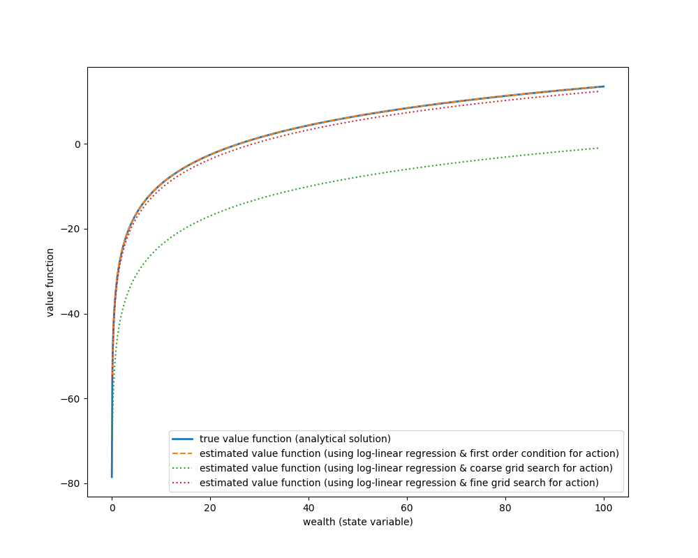

# Lifecycle Consumption and Savings

This is an extension of the cake eating problem in which the cake grows while the agent works.
The agent lives from age 25 to 85. Until they retire at 65, they earn an income that grows at random:
each year there's a 50% chance of a raise, uniformly distributed between 0% and 5%.
After they retire, their income is zero. Income at age 25 is 1, so all amounts are in units of starting salary.
Savings earn 1% interest, the agent can't borrow, and the discount factor is 0.95.

The agent's state is (wealth, income, age), and their action is the fraction of wealth + income to consume in the current period.
The reward is ln(consumption), exactly as in the cake eating problem. Compared to the cake eating problem:

* Time is finite (the problem ends when the agent dies at 85), so the value function and policy depend on age.
* State transitions are random (the agent doesn't know when they'll get a raise, or how big it will be).
* The state is three dimensional.
* Once the agent retires, this _is_ a cake eating problem (with a finite horizon, and interest on the cake).

Solutions:

* [consumption_savings.py](python/consumption_savings.py)

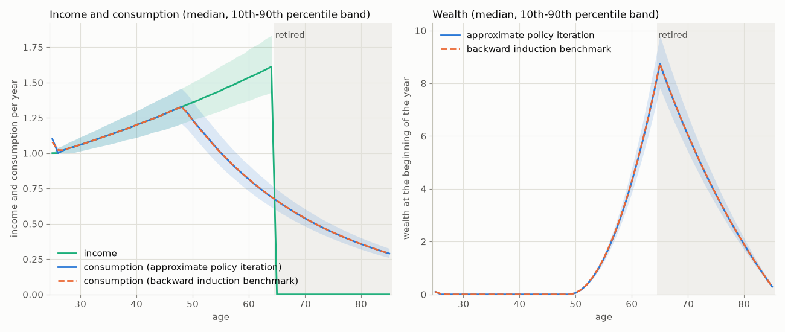

The agent spends all of their income, and holds no wealth, until their late 40s. They're impatient relative to the
interest rate (β(1 + r) = 0.95 × 1.01 ≈ 0.96 < 1) and they expect their income to grow, so they'd like to borrow
against their future income, but they can't. Once they start saving for retirement, their consumption declines smoothly,
with no drop at retirement: without news about their income, the Euler equation for log utility says that consumption
shrinks by a factor of β(1 + r) ≈ 0.96 every year.

The model is solved in two ways:

* **Approximate policy iteration**: evaluate the current policy by Monte Carlo simulation and fit a linear
  approximate value function, then update the policy by acting greedily with respect to that value function
  (the transition model is known, so the agent can calculate expected continuation values).
  Starting from a terrible initial policy (consume 1% of wealth + income every year), this converges within a couple of iterations.
* **Backward induction** on a grid of wealth and income, starting from age 85. This makes no assumptions about the shape
  of the value function, so we can use it as a benchmark, like the exact solution to the cake eating problem.

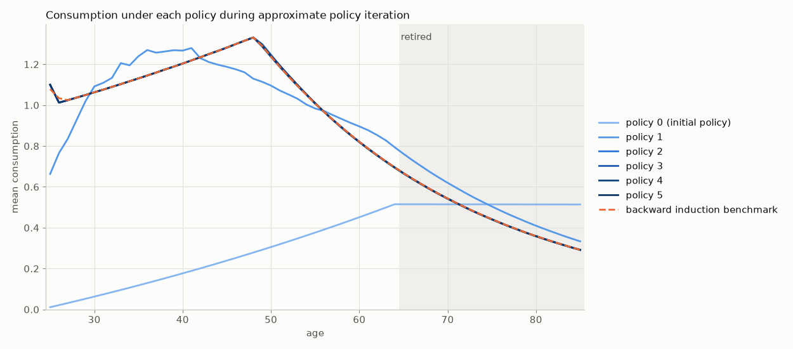

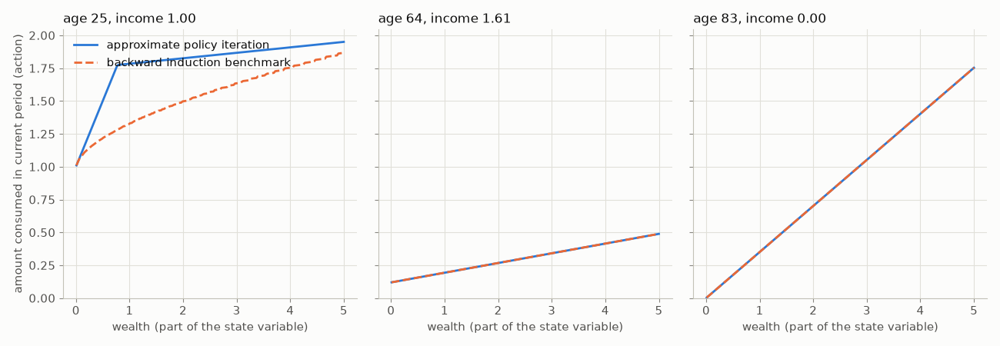

The approximate value function has a constant and a coefficient on ln(total wealth) at every age, where total wealth
is wealth + income + human wealth (the expected present value of future income).
If the agent faced no income risk and could borrow against their future income, this functional form would be exact,
and the coefficients would have a closed form: it's a finite horizon cake eating problem in which the cake is total wealth.
The closed form is exact for retired agents, and very close for working agents from their mid 30s on (their raises are small).
For younger agents, the borrowing constraint matters, the value function isn't linear in ln(total wealth),
and the estimated coefficients move away from the closed form:

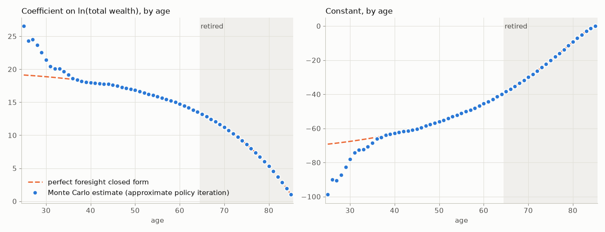

This is the weak point of the approximate solution. Along the simulated lifecycles, the two solutions agree closely,
but for young agents with more wealth than they would ever have in a simulation (see age 25 in the policy plot above),
approximate policy iteration's policy is noticeably different from the benchmark.

Things that turned out to matter for approximate policy iteration (without them, the agent consumed 99% of their
resources while working, and then saved most of their income in the year before retiring):

* **Features**: ln(wealth + income) leaves out future income. A 55 year old with no savings and ten more years of
  salary ahead of them is much richer than ln(wealth + income) suggests.
* **Exploring starts** (Sutton and Barto 5.3): when every episode starts from the same state and the policy is deterministic,
  there is almost no variation in wealth at any given age, so the slope of the value function with respect to wealth
  (exactly what the policy update needs) isn't identified. Each episode now starts at a random age, wealth and income.
* **Least squares instead of stochastic gradient descent**: gradient Monte Carlo (Sutton and Barto 9.3, one small step per visited state)
  barely moves the ln(wealth) coefficients, even after thousands of episodes, because the features are nearly collinear within an age.
  A least squares fit on a batch of episodes recovers the known coefficients.
* **E[V(next state)] instead of V(E[next state])**: the continuation value averages over the possible raises.

## Connections to Carroll's lecture notes on consumption

Christopher Carroll's [lecture notes on consumption](https://www.econ2.jhu.edu/people/ccarroll/public/lecturenotes/Consumption/)
cover this kind of model and many extensions. The most closely related notes:

* [Consumption Under Perfect Foresight and CRRA Utility](https://www.econ2.jhu.edu/people/ccarroll/public/LectureNotes/Consumption/PerfForesightCRRA):
  human wealth, total wealth, and consumption as a fraction of total wealth. This is where the feature ln(total wealth)
  and the closed form value function coefficients come from (log utility is CRRA utility with a coefficient of relative risk aversion of 1).
* [The Envelope Theorem and the Euler Equation](https://www.econ2.jhu.edu/people/ccarroll/public/LectureNotes/Consumption/Envelope):
  the Euler equation u'(c<sub>t</sub>) = Rβ u'(c<sub>t+1</sub>), which for log utility means c<sub>t+1</sub> = Rβ c<sub>t</sub>:
  the steady decline in consumption in the plot above.
* [The Fisher Two-Period Optimal Consumption Problem](https://www.econ2.jhu.edu/people/ccarroll/public/LectureNotes/Consumption/2PeriodLCModel):
  the two-period version of a lifecycle model.
* [Precautionary Saving and Precautionary Wealth](http://www.econ2.jhu.edu/people/ccarroll/papers/PalgravePrecautionary/)
  and [Risk Premia and Precautionary Premia](https://www.econ2.jhu.edu/people/ccarroll/public/LectureNotes/Consumption/RiskAndPSPremia):
  for a prudent consumer (log utility is prudent), income uncertainty increases saving. In this model the effect is tiny:
  precautionary saving lowers consumption by at most about 0.15% (around age 50) compared to an agent who is certain
  to get the average raise every year, because the raises are small (mean 1.25%, standard deviation 1.6% per year)
  and income never falls before retirement.
* [A Tractable Model of Buffer Stock Saving](https://www.econ2.jhu.edu/people/ccarroll/public/LectureNotes/Consumption/TractableBufferStock)
  and [Age Consumption/Income Profiles In Data and Theory](https://www.econ2.jhu.edu/people/ccarroll/public/LectureNotes/Consumption/BufferStockAgeProfiles):
  impatient consumers who face real downside risk, like unemployment, hold a buffer stock of wealth, and only start
  saving for retirement 10-15 years before they retire, so their consumption tracks their income for much of their working life.
  Consumption tracks income early in life in this model too, but without downside risk there's no reason to hold a buffer stock,
  so the agent holds no wealth at all. Adding a probability of unemployment is a natural next step for this model.
* [Solution Methods for Microeconomic Dynamic Stochastic Optimization Problems](https://llorracc.github.io/SolvingMicroDSOPs):
  numerical methods for lifecycle models like this one. The backward induction benchmark uses its trick of interpolating
  an "inverted" value function, which is close to linear, instead of the value function itself.

# Windy Gridworld

Solutions:

* [WindyGridWorld.elm](elm/src/WindyGridWorld.elm)
* [WindyGridWorld.jl](julia/WindyGridWorld.jl)
* [windy_gridworld.py](python/windy_gridworld.py)

This problem is loosely based on Figure 4.2 and on Example 6.5 in
[Reinforcement Learning](https://web.stanford.edu/class/psych209/Readings/SuttonBartoIPRLBook2ndEd.pdf)
by Sutton and Barto.

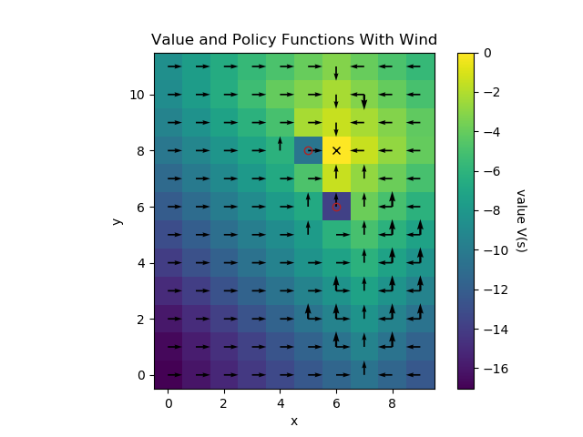

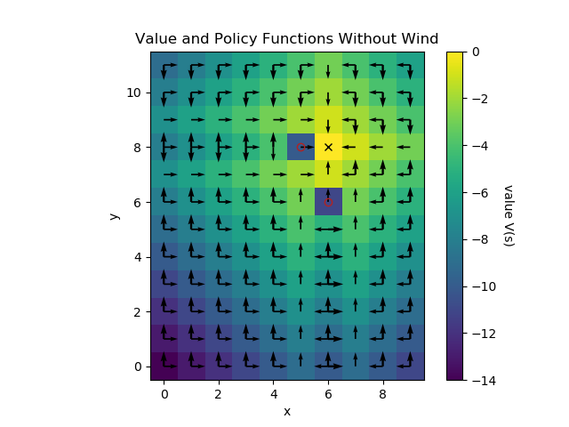

The agent's state is their (x, y) location on a grid,
and the actions are {stay, left, right, down, up}.
The problem is episodic, and ends when the agent reaches
the target location (the X in the image above). The
[reward is -1](python/windy_gridworld.py#L15)
in every period, so the agent's goal is to reach the
target in as few moves as possible.

There are two complications that make the problem interesting:

* Certain positions are "passable obstacles" (denoted by
red circles in the image above), and these are very costly (the
[reward is -10](python/windy_gridworld.py#L19)
; you can imagine the agent getting "stuck" for
10 moves if they walk into one of these locations).
* There is random "wind" in the up-down direction (y axis),
which sometimes pushes the agent [either up or down](python/windy_gridworld.py#L32)
beyond their intended move. This means the agent might be pushed into a
costly obstacle if they are either directly above or beneath it.
Notice that the optimal policy (black arrows in the figure above)
involves circumventing the obstacles by a wide margin in the
y direction.

The addition of randomness (the wind) changes the solution in
subtle ways:

* In the non-stochastic version of the problem (i.e. without wind),
there are many more ties in the policy function
(i.e. points in the state space at which there are multiple optimal actions).
There exist multiple paths of equal length that avoid the obstacles and reach the
target point in an optimal number of steps, and the agent has no reason to prefer
one such path above another. Adding wind breaks _most_ (but not all) ties:
with wind, the agent generally prefers to remain far from the obstacles (to reduce the
probability of being blown into one), but also has the possibility of using the wind
advantageously (by moving horizontally and letting the wind move the agent vertically).

* The value function is _generally_ lower with wind (because the agent now faces
the risk that they will hit an obstacle, even when they act optimally), but at
certain values of the wind probabilities and at certain points in the state space,
the reverse can be true.

* It is sometimes optimal for the agent to walk straight towards the obstacle!

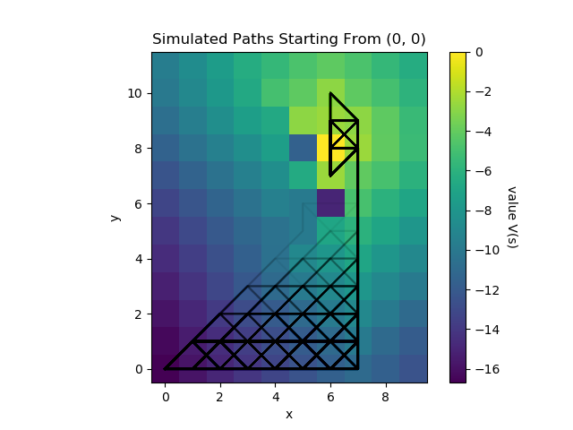

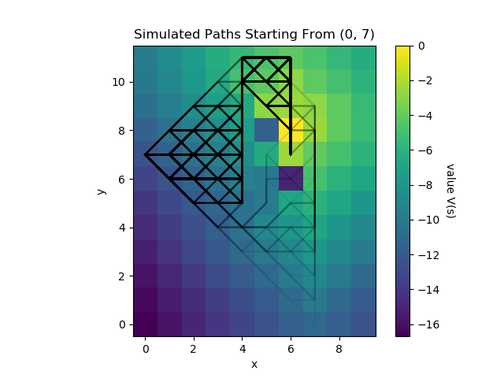

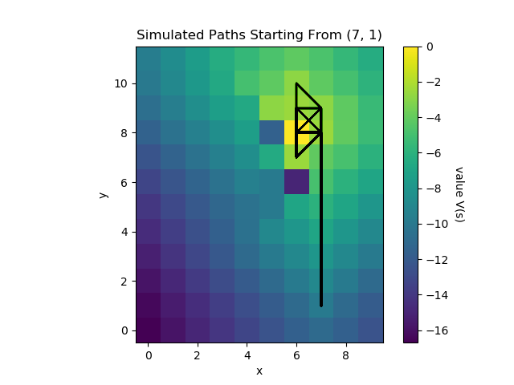

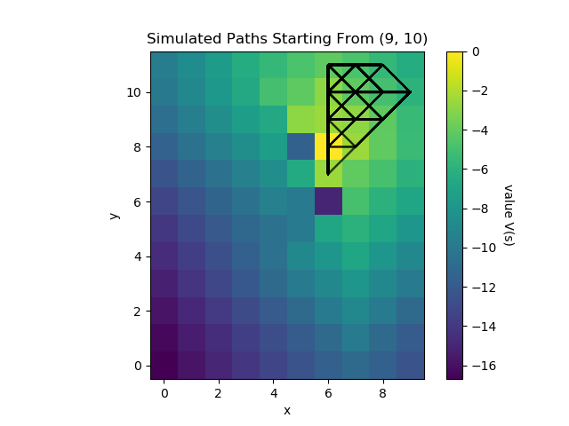