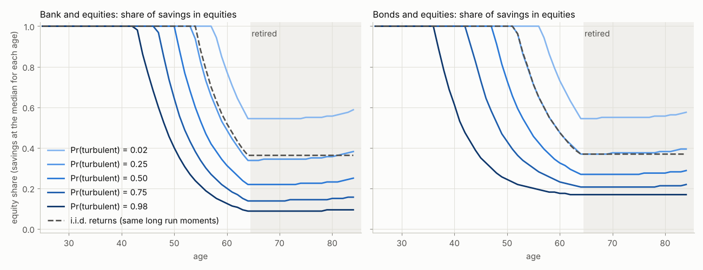
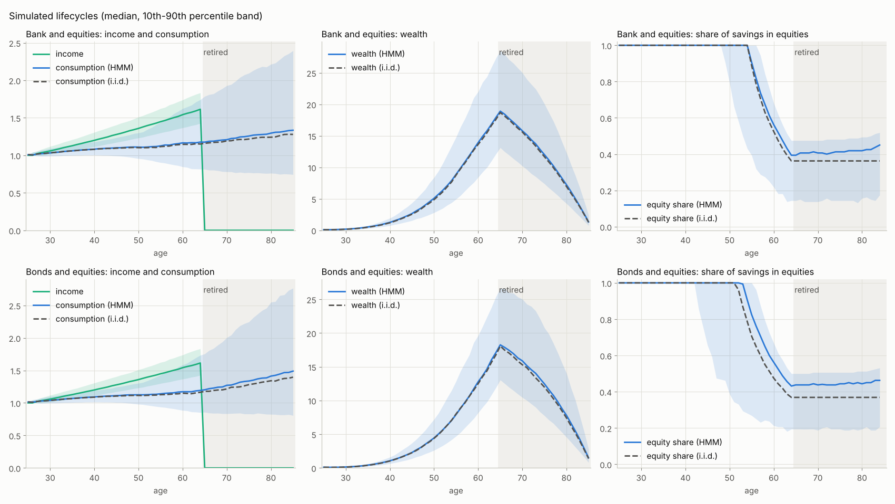
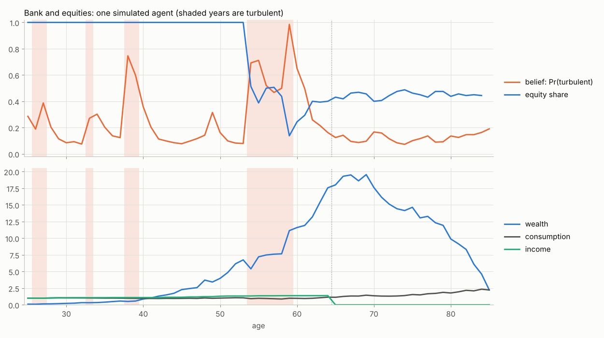

# markov_decision_process

Examples of Markov Decision Processes (MDPs)

## Running the Python code

The Python code uses [uv](https://docs.astral.sh/uv/) to manage dependencies
(pinned in [python/uv.lock](python/uv.lock)). From the `python` directory:

```bash
uv run python cake_eating.py
uv run python consumption_savings.py
uv run python consumption_portfolio_hmm.py
uv run python windy_gridworld.py
```

The first `uv run` creates a virtual environment and installs the locked dependencies.
The scripts save their plots to [python/plots](python/plots). To run the tests:

```bash
uv run pytest
```

# Cake Eating Problem

The agent's state is their wealth (amount of cake), and their action is how much to consume in the current period.
Time is discrete and infinite (the problem goes on forever), and state transitions are deterministic (there is no randomness).

The state space and action space are each infinite (which tends to make a problem difficult)
but only one dimensional (which makes a problem simple: there is no curse of dimensionality).
Interestingly, the cake eating problem can be solved (exactly) by hand, with pen and paper, and
this means we can compare approximate numerical solutions to the true solution and see how our MDP solver performed.

Related PDFs:

* http://users.ox.ac.uk/~exet2581/recursive/dp_mat.pdf describes a similar problem (a cake eating problem with a _finite_ time horizon), and
* http://www2.econ.iastate.edu/tesfatsi/dpintro.cooper.pdf describes this exact problem (the infinite-horizon cake eating problem).

Solutions:

* [cake_eating.py](python/cake_eating.py)


# Lifecycle Consumption and Savings

This is an extension of the cake eating problem in which the cake grows while the agent works.
The agent lives from age 25 to 85. Until they retire at 65, they earn an income that grows at random:
each year there's a 50% chance of a raise, uniformly distributed between 0% and 5%.
After they retire, their income is zero. Income at age 25 is 1, so all amounts are in units of starting salary.
Savings earn 1% interest, the agent can't borrow, and the discount factor is 0.95.

The agent's state is (wealth, income, age), and their action is the fraction of wealth + income to consume in the current period.
The reward is ln(consumption), exactly as in the cake eating problem. Compared to the cake eating problem:

* Time is finite (the problem ends when the agent dies at 85), so the value function and policy depend on age.
* State transitions are random (the agent doesn't know when they'll get a raise, or how big it will be).
* The state is three dimensional.
* Once the agent retires, this _is_ a cake eating problem (with a finite horizon, and interest on the cake).

Solutions:

* [consumption_savings.py](python/consumption_savings.py)


The agent spends all of their income, and holds no wealth, until their late 40s. They're impatient relative to the
interest rate (β(1 + r) = 0.95 × 1.01 ≈ 0.96 < 1) and they expect their income to grow, so they'd like to borrow
against their future income, but they can't. Once they start saving for retirement, their consumption declines smoothly,
with no drop at retirement: without news about their income, the Euler equation for log utility says that consumption
shrinks by a factor of β(1 + r) ≈ 0.96 every year.

The model is solved in two ways:

* **Approximate policy iteration**: evaluate the current policy by Monte Carlo simulation and fit a linear
  approximate value function, then update the policy by acting greedily with respect to that value function
  (the transition model is known, so the agent can calculate expected continuation values).
  Starting from a terrible initial policy (consume 1% of wealth + income every year), this converges within a couple of iterations.
* **Backward induction** on a grid of wealth and income, starting from age 85. This makes no assumptions about the shape
  of the value function, so we can use it as a benchmark, like the exact solution to the cake eating problem.


The approximate value function has a constant and a coefficient on ln(total wealth) at every age, where total wealth
is wealth + income + human wealth (the expected present value of future income).
If the agent faced no income risk and could borrow against their future income, this functional form would be exact,
and the coefficients would have a closed form: it's a finite horizon cake eating problem in which the cake is total wealth.
The closed form is exact for retired agents, and very close for working agents from their mid 30s on (their raises are small).
For younger agents, the borrowing constraint matters, the value function isn't linear in ln(total wealth),
and the estimated coefficients move away from the closed form:


This is the weak point of the approximate solution. Along the simulated lifecycles, the two solutions agree closely,
but for young agents with more wealth than they would ever have in a simulation (see age 25 in the policy plot above),
approximate policy iteration's policy is noticeably different from the benchmark.

Things that turned out to matter for approximate policy iteration (without them, the agent consumed 99% of their
resources while working, and then saved most of their income in the year before retiring):

* **Features**: ln(wealth + income) leaves out future income. A 55 year old with no savings and ten more years of
  salary ahead of them is much richer than ln(wealth + income) suggests.
* **Exploring starts** (Sutton and Barto 5.3): when every episode starts from the same state and the policy is deterministic,
  there is almost no variation in wealth at any given age, so the slope of the value function with respect to wealth
  (exactly what the policy update needs) isn't identified. Each episode now starts at a random age, wealth and income.
* **Least squares instead of stochastic gradient descent**: gradient Monte Carlo (Sutton and Barto 9.3, one small step per visited state)
  barely moves the ln(wealth) coefficients, even after thousands of episodes, because the features are nearly collinear within an age.
  A least squares fit on a batch of episodes recovers the known coefficients.
* **E[V(next state)] instead of V(E[next state])**: the continuation value averages over the possible raises.

## Connections to Carroll's lecture notes on consumption

Christopher Carroll's [lecture notes on consumption](https://www.econ2.jhu.edu/people/ccarroll/public/lecturenotes/Consumption/)
cover this kind of model and many extensions. The most closely related notes:

* [Consumption Under Perfect Foresight and CRRA Utility](https://www.econ2.jhu.edu/people/ccarroll/public/LectureNotes/Consumption/PerfForesightCRRA):
  human wealth, total wealth, and consumption as a fraction of total wealth. This is where the feature ln(total wealth)
  and the closed form value function coefficients come from (log utility is CRRA utility with a coefficient of relative risk aversion of 1).
* [The Envelope Theorem and the Euler Equation](https://www.econ2.jhu.edu/people/ccarroll/public/LectureNotes/Consumption/Envelope):
  the Euler equation u'(c<sub>t</sub>) = Rβ u'(c<sub>t+1</sub>), which for log utility means c<sub>t+1</sub> = Rβ c<sub>t</sub>:
  the steady decline in consumption in the plot above.
* [The Fisher Two-Period Optimal Consumption Problem](https://www.econ2.jhu.edu/people/ccarroll/public/LectureNotes/Consumption/2PeriodLCModel):
  the two-period version of a lifecycle model.
* [Precautionary Saving and Precautionary Wealth](http://www.econ2.jhu.edu/people/ccarroll/papers/PalgravePrecautionary/)
  and [Risk Premia and Precautionary Premia](https://www.econ2.jhu.edu/people/ccarroll/public/LectureNotes/Consumption/RiskAndPSPremia):
  for a prudent consumer (log utility is prudent), income uncertainty increases saving. In this model the effect is tiny:
  precautionary saving lowers consumption by at most about 0.15% (around age 50) compared to an agent who is certain
  to get the average raise every year, because the raises are small (mean 1.25%, standard deviation 1.6% per year)
  and income never falls before retirement.
* [A Tractable Model of Buffer Stock Saving](https://www.econ2.jhu.edu/people/ccarroll/public/LectureNotes/Consumption/TractableBufferStock)
  and [Age Consumption/Income Profiles In Data and Theory](https://www.econ2.jhu.edu/people/ccarroll/public/LectureNotes/Consumption/BufferStockAgeProfiles):
  impatient consumers who face real downside risk, like unemployment, hold a buffer stock of wealth, and only start
  saving for retirement 10-15 years before they retire, so their consumption tracks their income for much of their working life.
  Consumption tracks income early in life in this model too, but without downside risk there's no reason to hold a buffer stock,
  so the agent holds no wealth at all. Adding a probability of unemployment is a natural next step for this model.
* [Solution Methods for Microeconomic Dynamic Stochastic Optimization Problems](https://llorracc.github.io/SolvingMicroDSOPs):
  numerical methods for lifecycle models like this one. The backward induction benchmark uses its trick of interpolating
  an "inverted" value function, which is close to linear, instead of the value function itself.

# Lifecycle Consumption, Savings and Portfolio Choice with Regime-Switching Returns

This extends the lifecycle model above: same lifespan, retirement age, income process, discount factor and borrowing
constraint, but each year the agent also splits their savings between a safer asset and equities. Equities pay
more on average, but returns depend on a hidden **regime** that follows a Markov chain. This is the Gaussian
regime-switching hidden Markov model (HMM) from [finance_playground#1](https://github.com/atorch/finance_playground/pull/1),
extended to a vector of returns (sec. 6.3 of [van Handel's HMM notes](https://www.princeton.edu/~rvan/orf557/hmm080728.pdf)):

* The regime X<sub>t</sub> ∈ {calm, turbulent} is a Markov chain. A calm year is followed by another calm year with probability 0.9,
  and a turbulent year is followed by another turbulent year with probability 0.75 (about 29% of years are turbulent in the long run).
* Given the regime, the vector of annual log returns (safer asset, equities) is normally distributed, with a mean vector and covariance matrix that depend on the regime.

| | calm | turbulent |
|---|---|---|
| equities: mean log return, volatility | 9%, 13% | -2%, 28% |
| bonds: mean log return, volatility | 2%, 6% | 3%, 8% |
| correlation between bond and equity returns | 0.2 | -0.4 (flight to quality) |

There are two versions of the safer asset: a **bank** account that pays 1% in every regime (as in the model above), or
**bonds**, which are risky but much less risky than equities, and hedge equities in turbulent years.

The agent never sees the regime. They know the HMM's parameters, observe realized returns, and update their **belief**
(a probability vector over regimes) with Bayes' rule, which is exactly the forward algorithm of the HMM.
A partially observed MDP like this one becomes an ordinary MDP if the belief is part of the state, so the state is
(wealth, income, age, belief) and the action is (consumption, share of savings in equities). No shorting, no leverage.

The reward is CRRA utility with a coefficient of relative risk aversion of 5. With log utility (the model above),
the agent would hold 100% equities in calm times at every age, and their portfolio choice would be myopic
(Samuelson 1969, Merton 1969: a log utility investor ignores what this year's returns say about future returns).

Solutions:

* [consumption_portfolio_hmm.py](python/consumption_portfolio_hmm.py): the lifecycle model, solved by backward induction
* [hmm.py](python/hmm.py): a Gaussian HMM with vector-valued returns (filtering, forward-backward, Baum-Welch EM), a Python port of the R code in finance_playground
* Tests: [test_consumption_portfolio_hmm.py](python/test_consumption_portfolio_hmm.py), [test_hmm.py](python/test_hmm.py)

## How do beliefs about risk change the lifecycle portfolio?



Each line is the optimal equity share at every age for an agent with a fixed belief about the current regime (holding
savings at the simulated median for each age). The dashed line is an agent who believes returns are i.i.d., with
the same long run mean and covariance as the HMM.

* **Young workers hold 100% equities, whatever they believe.** Their future income is a large, bond-like asset,
  so equities are only a small share of their total (financial + human) wealth. They'd like to hold more than
  100% of their savings in equities, but they can't borrow.
* **The glide path from equities to the safer asset starts when human wealth runs out, and it starts much earlier when the agent thinks the market is turbulent.**
  With a bank account, an agent who's sure that the market is calm stays 100% in equities until 57; an agent who's
  sure it's turbulent starts moving to the bank at 42. So yes: in periods of higher (perceived) risk, older workers
  move to bonds sooner and further. The belief matters more for older agents, because the borrowing constraint pins young
  agents at 100% equities.
* **Retirees' portfolios depend on their belief, not their wealth.** With CRRA utility and no income, the portfolio
  doesn't depend on wealth, so in retirement the lines are flat in age, apart from the next point. A retiree who thinks
  the market is calm holds 55% equities; one who thinks it's turbulent holds 9% (bank) or 17% (bonds).
* **Hedging demand.** The retirees' lines slope up slightly with age. A bad year for equities is also news that the
  regime is probably turbulent, so equities lose value exactly when future investment opportunities get worse. An agent
  with risk aversion above 1 dislikes that, and holds less equity than the one-year-ahead (myopic) optimum:
  about 4 percentage points less at 65. The hedging motive shrinks as the horizon shrinks, and at 84 (one year
  before the agent dies) the portfolio is myopic. With log utility the hedging demand is exactly zero (there's a test for that).
* **Bonds vs a bank account.** With bonds, the turbulent-regime glide path is less extreme (17% rather than 9% equities
  in retirement), because bonds pay more than the bank and hedge equities in turbulent years.



Along simulated lifecycles, beliefs are usually calm-ish (the median Pr(turbulent) is about 0.15), so the median agent
under the HMM holds slightly more equities in retirement than the i.i.d. agent. Wealth and consumption are nearly the same
under the two models: regime switching changes the _portfolio_ much more than it changes _how much_ the agent saves.



One simulated agent (bank and equities). The belief jumps after bad equity years, and the agent's equity share
responds once human wealth no longer pins it at 100%. The belief is a noisy signal of the regime: it spikes in some
calm years (a bad year can happen in a calm regime too), and it hovers around 0.5 for part of a long turbulent spell.

## Solution method

Backward induction on a grid, with the belief as a state variable. Three tricks keep it fast (about 20 seconds with
the bank and 2 minutes with bonds):

* **Homotheticity.** With CRRA utility, and income that only ever gets multiplied by (1 + raise), scaling wealth and income
  by the same factor scales all future consumption by that factor. So V(wealth, income, age, belief) =
  income<sup>1-γ</sup> v(wealth / income, age, belief), and the working-age state is two dimensional: (wealth / income, belief).
  Retirees have no income, so their value is wealth<sup>1-γ</sup> u(age, belief), and their consumption rate and portfolio only depend on their belief.
* **Post-decision states** (Sutton and Barto's _afterstates_, sec. 6.8). The best portfolio only depends on how much
  the agent saves, so we first solve for the best portfolio and the expected continuation value on a grid of
  (savings / income, belief), and then choose consumption with a one dimensional search.
* **Interpolating the inverted value function**, ((1 - γ) v)<sup>1/(1-γ)</sup>, which is close to linear in wealth, as in the benchmark above.

Expectations are over next year's regime (given the current belief), returns given the regime (Gauss-Hermite quadrature),
and raises. Next year's belief is the filter applied to the quadrature returns, so the agent anticipates how they'll learn.

Checks (`uv run pytest`):

* With log utility and only a bank account, the solution matches the backward induction benchmark in
  [consumption_savings.py](python/consumption_savings.py) (consumption within about 1% everywhere), even though it's solved on a different state space.
* With log utility, retirees' portfolios are myopic (they maximize E[ln(portfolio return)] over next year), and they consume 1 / (1 + β + β<sup>2</sup> + ...) of their wealth.
* One year before death, retirees' portfolios are myopic for any risk aversion.
* The HMM's forward-backward algorithm matches brute force enumeration of every regime path, a riskless asset doesn't
  change the filter, EM recovers the parameters of simulated data, and a 1-regime HMM is the i.i.d. Gaussian MLE (the same sanity check as in finance_playground).

## Next steps

* **Estimate the HMM** (with `hmm.fit_gaussian_hmm`) on real annual (or monthly, aggregated) stock and bond returns, rather than using made-up parameters.
  Annual data gives few observations per regime, so the parameters will be uncertain; an agent who also learns the parameters is a harder problem.
* **K > 2 regimes.** The code is written for K regimes (the belief grid has K - 1 dimensions), but has only been run with K ≤ 2.
  For K ≥ 3 the product grid over beliefs includes points off the simplex, and the grid grows quickly.
* **Approximate policy iteration**, as in the model above, with the belief as a feature. Grid-based backward induction won't scale to many regimes or assets.
* **Income risk correlated with the regime** (unemployment in turbulent years), which would make human wealth more equity-like and change the young agent's portfolio.
* The consumption-fraction-by-belief table that the script prints is confounded by wealth (agents who believe the market is turbulent have usually just had bad returns), so it's not a clean measure of how beliefs change saving.

# Windy Gridworld

Solutions:

* [WindyGridWorld.elm](elm/src/WindyGridWorld.elm)
* [WindyGridWorld.jl](julia/WindyGridWorld.jl)
* [windy_gridworld.py](python/windy_gridworld.py)

This problem is loosely based on Figure 4.2 and on Example 6.5 in
[Reinforcement Learning](https://web.stanford.edu/class/psych209/Readings/SuttonBartoIPRLBook2ndEd.pdf)
by Sutton and Barto.


The agent's state is their (x, y) location on a grid,
and the actions are {stay, left, right, down, up}.
The problem is episodic, and ends when the agent reaches
the target location (the X in the image above). The
[reward is -1](python/windy_gridworld.py#L15)
in every period, so the agent's goal is to reach the
target in as few moves as possible.

There are two complications that make the problem interesting:

* Certain positions are "passable obstacles" (denoted by
red circles in the image above), and these are very costly (the
[reward is -10](python/windy_gridworld.py#L19)
; you can imagine the agent getting "stuck" for
10 moves if they walk into one of these locations).
* There is random "wind" in the up-down direction (y axis),
which sometimes pushes the agent [either up or down](python/windy_gridworld.py#L32)
beyond their intended move. This means the agent might be pushed into a
costly obstacle if they are either directly above or beneath it.
Notice that the optimal policy (black arrows in the figure above)
involves circumventing the obstacles by a wide margin in the
y direction.

The addition of randomness (the wind) changes the solution in
subtle ways:

* In the non-stochastic version of the problem (i.e. without wind),
there are many more ties in the policy function
(i.e. points in the state space at which there are multiple optimal actions).
There exist multiple paths of equal length that avoid the obstacles and reach the
target point in an optimal number of steps, and the agent has no reason to prefer
one such path above another. Adding wind breaks _most_ (but not all) ties:
with wind, the agent generally prefers to remain far from the obstacles (to reduce the
probability of being blown into one), but also has the possibility of using the wind
advantageously (by moving horizontally and letting the wind move the agent vertically).

* The value function is _generally_ lower with wind (because the agent now faces
the risk that they will hit an obstacle, even when they act optimally), but at
certain values of the wind probabilities and at certain points in the state space,
the reverse can be true.

* It is sometimes optimal for the agent to walk straight towards the obstacle!


